# Manual de utilização — FixIt

Este é o manual da aplicação FixIt, a oficina de reparação usada como projecto
final. Explica o trabalho do balcão e o que o cliente vê do outro lado, ecrã a
ecrã, com as regras que a aplicação aplica — não as que gostaríamos que
aplicasse.

Está escrito para quem trabalha na oficina. Não pressupõe conhecimentos de
informática além de saber usar um browser.

**Como ler este manual.** Os números das secções seguem a ordem de um dia de
trabalho: entrar, ver o painel, registar, acompanhar, cobrar, entregar. Se
precisares de consultar uma coisa só, o índice no fim leva-te lá.

---

## Índice

1. [O que é o FixIt](#1-o-que-é-o-fixit)
2. [Antes de começar](#2-antes-de-começar)
3. [Entrar, sair e sessões](#3-entrar-sair-e-sessões)
4. [O painel](#4-o-painel)
5. [Registar um pedido novo](#5-registar-um-pedido-novo)
6. [A lista de pedidos](#6-a-lista-de-pedidos)
7. [A ficha do pedido](#7-a-ficha-do-pedido)
8. [Os cinco estados](#8-os-cinco-estados)
9. [Orçamentos](#9-orçamentos)
10. [O PIN e a consulta pública](#10-o-pin-e-a-consulta-pública)
11. [Pedidos de orçamento do site](#11-pedidos-de-orçamento-do-site)
12. [Clientes](#12-clientes)
13. [Equipamentos](#13-equipamentos)
14. [Utilizadores](#14-utilizadores)
15. [A minha conta](#15-a-minha-conta)
16. [O site público](#16-o-site-público)
17. [Um dia na oficina](#17-um-dia-na-oficina)
18. [Mensagens e erros](#18-mensagens-e-erros)
19. [Boas práticas no balcão](#19-boas-práticas-no-balcão)
20. [Limitações conhecidas](#20-limitações-conhecidas)
21. [Glossário](#21-glossário)

---

## 1. O que é o FixIt

O FixIt faz duas coisas, com dois públicos diferentes:

- **No balcão** regista-se o equipamento que entra, emite-se um PIN para o
  cliente acompanhar, escreve-se o orçamento, muda-se o estado à medida que o
  trabalho avança e entrega-se o equipamento.
- **No site** o cliente pede orçamento, consulta o estado da reparação com o
  PIN do talão e lê o que a oficina faz.

As duas metades partilham a mesma base de dados, mas não a mesma sessão: sair da
oficina não fecha a consulta do cliente, e entrar na oficina não interfere com
ela.

O que a aplicação **não** faz: não envia emails, não processa pagamentos e não
guarda ficheiros fora do servidor onde corre.

---

## 2. Antes de começar

### O que precisas

- Um browser actualizado: Chrome, Edge, Firefox ou Safari.
- O endereço da aplicação. Se estiver a correr no teu computador, é
  <http://127.0.0.1:8141/>.
- Uma conta com palavra-passe, criada por um administrador.

### Os dois lados

| Endereço | Para quem | Serve para |
| --- | --- | --- |
| `/` ou `/frontoffice/index.php` | Clientes | Conhecer a oficina, pedir orçamento e consultar o estado por PIN |
| `/backoffice/login.php` | Equipa da oficina | Registar e acompanhar o trabalho |

O site público não mostra nada do back office. Quem visita o site vê a oficina
e, com um PIN válido, o percurso do seu próprio pedido — nunca a lista de
clientes nem o trabalho dos outros.

### O mapa das páginas

**Área da oficina** (exige sessão):

| Página | Endereço | Para que serve |
| --- | --- | --- |
| Entrada | `login.php` | Iniciar sessão |
| Painel | `painel.php` | Resumo do dia e fila de trabalho |
| Pedidos | `pedidos.php` | Lista completa, com filtros e mudança de estado |
| Ficha | `pedido.php?id=N` | Tudo sobre um pedido |
| Novo pedido | `pedido-novo.php` | Registo no balcão e emissão do PIN |
| Pedidos do site | `solicitacoes.php` | Caixa de entrada dos pedidos de orçamento |
| Clientes | `clientes.php` | Quem já passou pela oficina |
| Equipamentos | `equipamentos.php` | As máquinas e o seu histórico |
| Utilizadores | `utilizadores.php` | Contas da equipa (só administradores) |
| A minha conta | `conta.php` | A tua palavra-passe e as tuas sessões |

**Site público:**

| Página | Endereço |
| --- | --- |
| Início | `index.php` |
| O que reparamos | `servicos.php` |
| Como funciona | `como-funciona.php` |
| Perguntas | `perguntas.php` |
| Contacto | `contacto.php` |
| Privacidade | `privacidade.php` |
| Pedir orçamento | `orcamento.php` |
| Consultar estado | `consulta.php` |

---

## 3. Entrar, sair e sessões

### Entrar

1. Abre `/backoffice/login.php`. A página tem duas metades: à esquerda a marca
   e o percurso de uma reparação, à direita o formulário.
2. Escreve o **email** e a **palavra-passe**. No ecrã do balcão o cursor já
   está no email; no telemóvel não, para o teclado não tapar a página.
3. Para veres o que escreveste, carrega em **Mostrar**, ao lado do campo: a
   palavra-passe aparece e o botão passa a **Ocultar**.
4. Carrega em **Entrar**.

Se os dados estiverem errados, a página diz «Email ou palavra-passe
incorretos» — a mesma frase para os dois casos, de propósito, para não dizer a
quem tenta adivinhar se o email existe.

Três ajudas que a página dá sem ser preciso perguntar:

- **Caps Lock.** Se a tecla estiver ligada com o campo da palavra-passe em foco,
  aparece «A tecla Caps Lock está ligada.» por baixo do campo. É a causa mais
  comum de uma palavra-passe certa ser recusada.
- **Saltar para o formulário.** A primeira paragem do Tab não é a marca: é uma
  ligação que salta a apresentação toda. Só se vê quando tem foco.
- **Tema.** O sol no canto troca entre papel e tinta. A escolha fica neste
  browser, não na conta — quem partilha o computador da receção não muda o ecrã
  do colega.

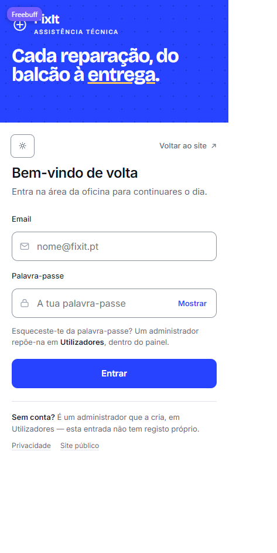

### A sessão dura 8 horas

Uma sessão sem atividade caduca ao fim de **8 horas**. Passado esse tempo, a
página seguinte devolve-te ao login. Não se perde trabalho: o que estava a ser
escrito num formulário perde-se, mas nada do que já foi gravado.

### Sair

O botão **SAIR**, no canto superior direito, termina a sessão nesse computador.
É um botão e não uma ligação, porque sair altera o estado do servidor e não deve
poder ser disparado por outra página.

### Esqueceste-te da palavra-passe?

Não há recuperação por email. Pede a um administrador que use **Utilizadores →
Repor palavra-passe** na tua conta. A palavra-passe nova tem de ter pelo menos
**8 caracteres**.

Mudar a palavra-passe termina as sessões abertas noutros computadores; a sessão
onde a mudança foi feita continua aberta.

---

## 4. O painel

O painel é a primeira página depois do login e responde a uma pergunta: «como
está a oficina agora?».

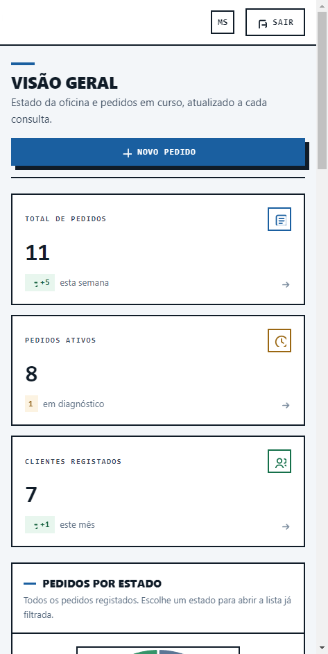

De cima para baixo:

- **Total de pedidos**, **Pedidos ativos** (tudo o que ainda não está
  «Entregue») e **Clientes registados**. Cada número traz a variação da semana
  ou do mês.
- **Pedidos por estado** — um gráfico de anéis, com a legenda ao lado. Clicar
  num estado abre a lista de pedidos já filtrada por ele. A legenda tem os
  mesmos números do gráfico, por isso a informação não depende de a biblioteca
  do gráfico carregar.
- A **fila de trabalho**: os pedidos que estão à espera de alguém, com atalhos
  para os recortes que interessam (por atribuir, prontos, entregues).
- **Avisos**: pedidos cujo PIN não é consultado há mais de uma semana. Não é
  erro do cliente — é sinal de que o talão pode ter ficado na gaveta.

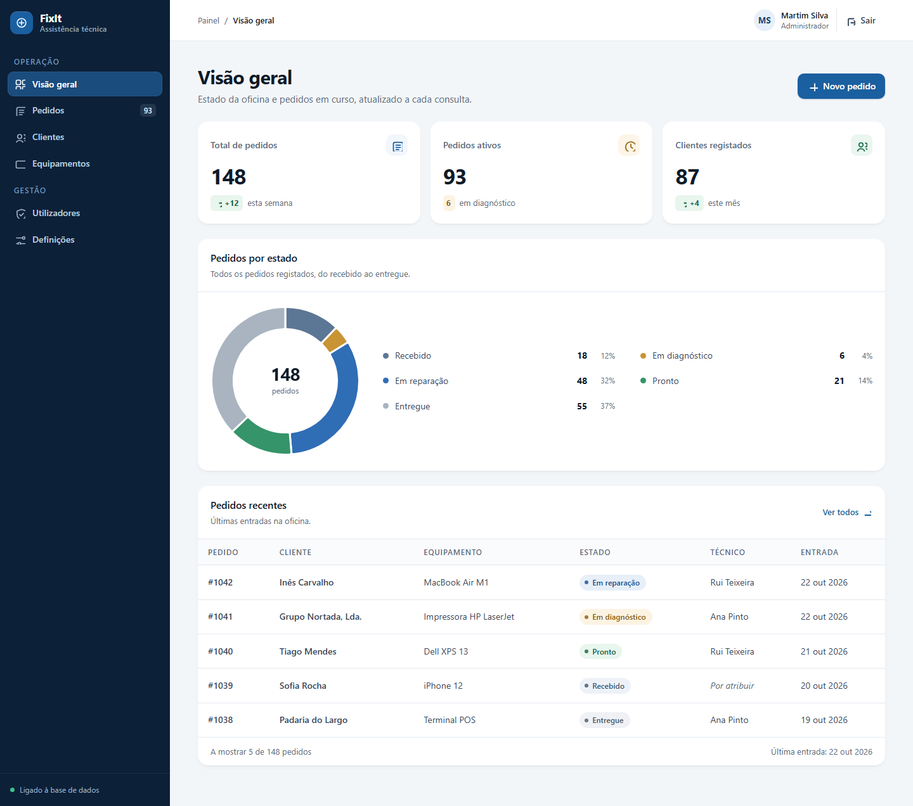

### No telemóvel

Em ecrãs estreitos o menu lateral recolhe para um botão no topo. Toca nele para
abrir a gaveta, e em **Escape** ou na cortina escura para fechar. As tabelas
passam a cartões, para não obrigarem a arrastar para o lado.

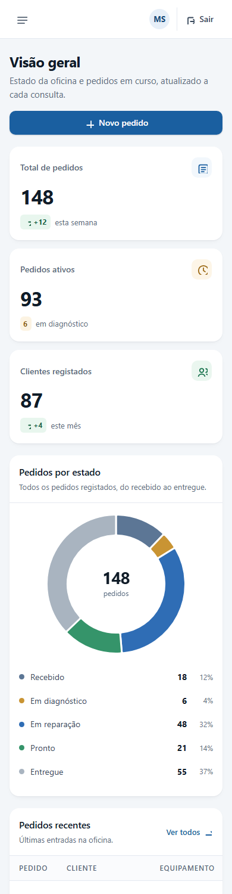

---

## 5. Registar um pedido novo

Um pedido só nasce no balcão, com o equipamento à frente. É isso que garante o
PIN e o talão — e é por isso que o site não cria pedidos, só pedidos de
orçamento.

1. No painel, carrega em **Novo pedido** (ou no menu, **Pedidos → Novo pedido**).
2. **Cliente.** Escolhe um cliente que já existe ou escreve os dados de um novo:
   nome, NIF, telefone e email.
3. **Equipamento.** Tipo, marca e modelo. O número de série é opcional.
4. **Avaria.** Descreve o problema **como o cliente o contou**. Este texto é o
   que ele vai ler na consulta pública.
5. **Fotografias.** Até **5** imagens, **5 MB** cada (opcional, mas é o que
   protege a oficina numa discussão sobre riscos).
6. Carrega em **Registar pedido**.

No fim, a aplicação mostra o **PIN de 6 dígitos** e a referência do pedido.

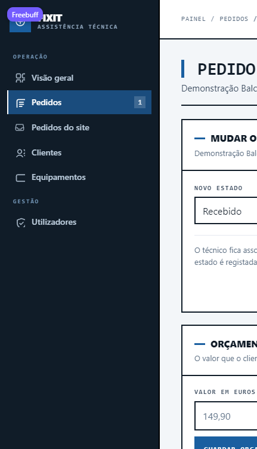

> **Entrega o PIN por escrito.** Sem ele o cliente não consegue consultar nada,
> e não há forma de o cliente o recuperar sozinho.

### Se um campo estiver mal preenchido

A página não perde o que escreveste. O campo errado fica assinalado, com a razão
ao lado (por exemplo «Indica um NIF com 9 dígitos»), e a gravação só acontece
quando tudo estiver correcto.

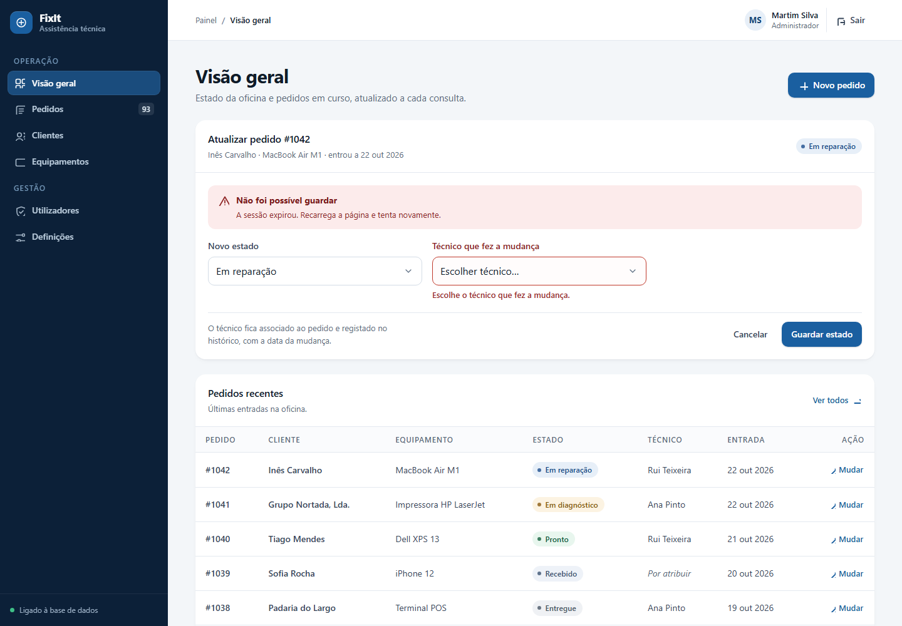

### Limites das fotografias

| Regra | Valor |
| --- | --- |
| Fotografias por pedido | 5 |
| Tamanho de cada ficheiro | 5 MB |
| Formatos aceites | JPEG, PNG e WebP (o tipo é confirmado pelo conteúdo, não pela extensão) |
| Onde ficam | Na pasta `uploads/`, com um `.htaccess` que impede lá correr scripts |

Se o servidor tiver um limite de upload menor do que o da aplicação, a mensagem
diz «O ficheiro excede o limite de tamanho configurado no servidor» e o pedido
não é gravado com metade das fotos: ou entram todas as que escolheste, ou não
entra nenhuma.

---

## 6. A lista de pedidos

**Pedidos** mostra todas as ordens de serviço da oficina, por páginas de **20**.

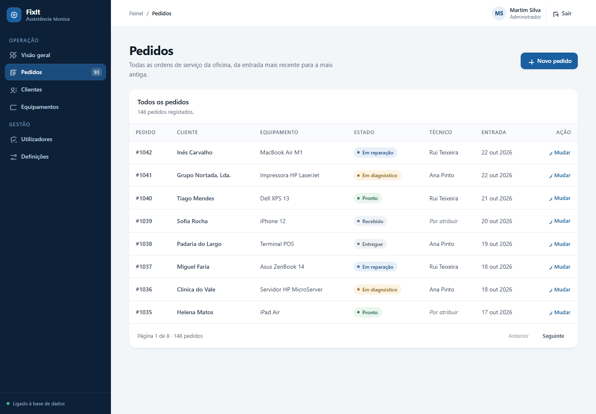

### Pesquisar

A pesquisa procura ao mesmo tempo no **nome do cliente**, no **NIF**, no
**PIN** e no **número de série**. Um telefone parcial como `912` encontra os
números que o contenham.

### Filtrar

Os filtros combinam-se entre si:

| Filtro | Valores |
| --- | --- |
| Estado | Por entregar, Recebido, Em diagnóstico, Em reparação, Pronto, Entregue |
| Técnico | Todos, por atribuir, ou o nome de cada técnico |
| Consultas | Todas, algumas, nenhuma, há mais de uma semana |

O resumo por baixo dos filtros mostra quantos pedidos há em cada estado e por
técnico — e cada linha é uma ligação que aplica esse recorte.

### Ordenar

A lista ordena por **entrada**, por **estado** (a ordem do ciclo de vida), pela
**última consulta** ao PIN ou pela **espera do PIN**, em qualquer dos sentidos.

### Quando não há resultados

A lista não fica vazia nem em branco: explica que não há resultados e oferece a
limpeza dos filtros.

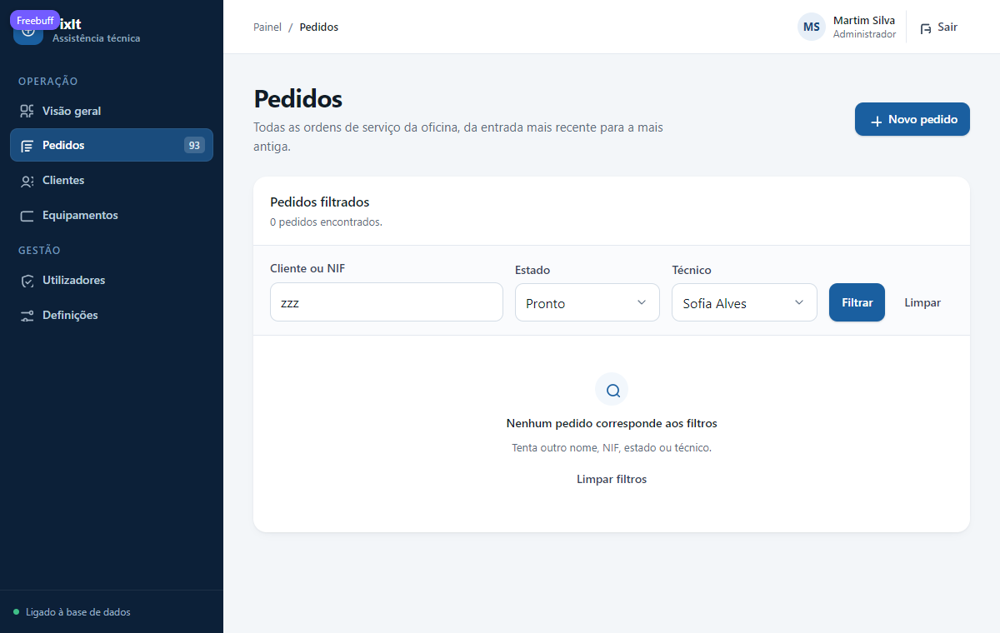

### No telemóvel

A tabela transforma-se em cartões, um por pedido, com os mesmos dados e as
mesmas ações.

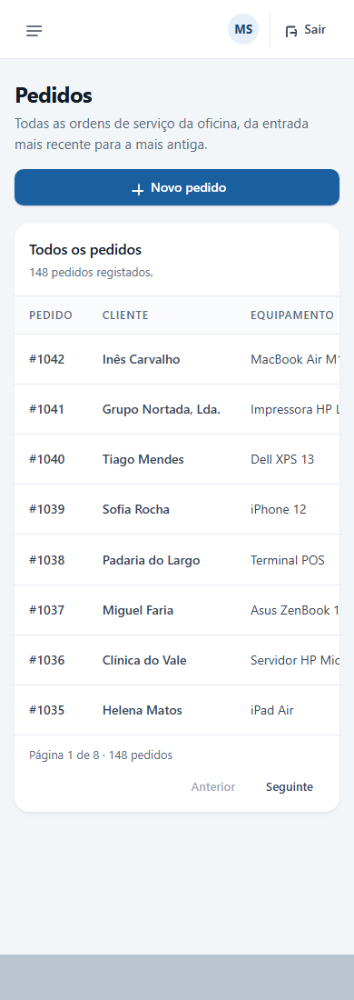

---

## 7. A ficha do pedido

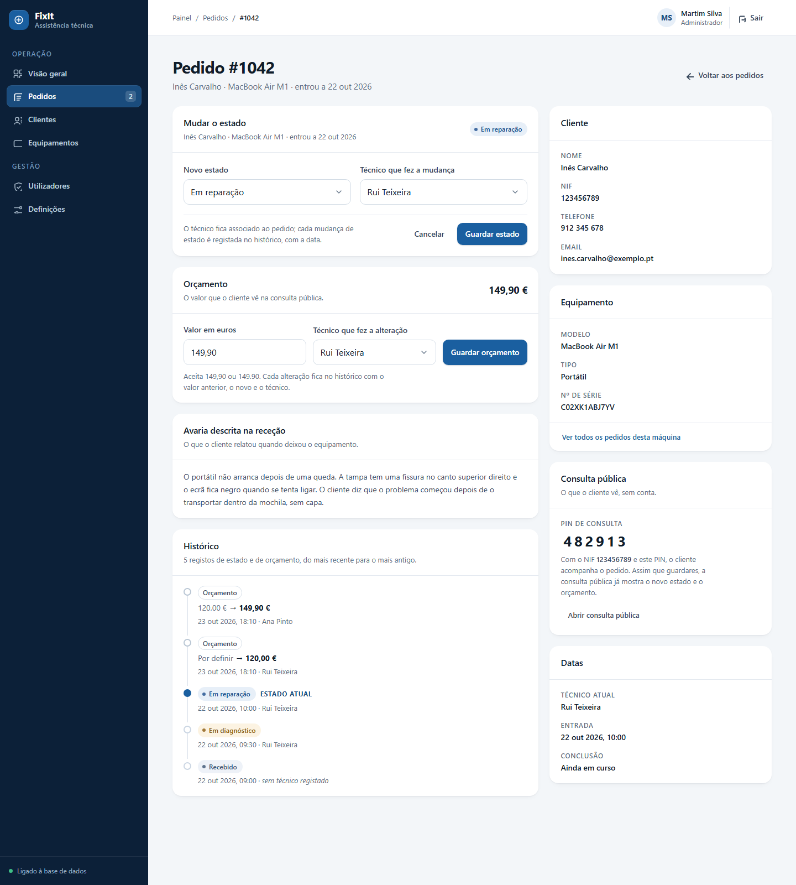

A ficha reúne tudo o que se sabe de um pedido:

- **Cliente e equipamento**, com o contacto à mão para ligar.
- **Percurso** — as cinco fases, com a data em que cada uma aconteceu. A fase
  actual está assinalada.
- **Orçamento** — o valor actual e o histórico de todos os valores anteriores.
- **Histórico de estados**, com a data e o nome de quem fez cada mudança.
- **PIN** — o actual, quantas vezes foi consultado e o botão para o renovar.
- **Fotografias** — as imagens tiradas à entrada. Clicar numa abre-a em tamanho
  real.

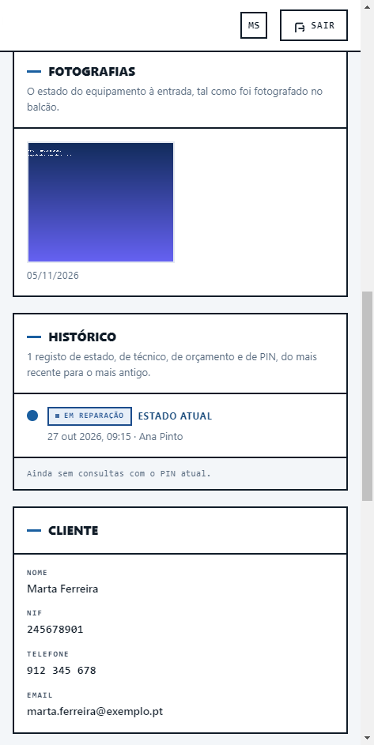

### O que a ficha não mostra

O histórico do PIN regista **quando** foi emitido ou renovado e **por quem**,
mas nunca o código. Um PIN não se lê no histórico: só se gera outro.

---

## 8. Os cinco estados

O percurso é o mesmo para todos os pedidos:

| Estado | O que significa | Quem o põe |
| --- | --- | --- |
| **Recebido** | O equipamento entrou e o PIN foi emitido | O registo no balcão |
| **Em diagnóstico** | Alguém está a ver o que se passa | A equipa |
| **Em reparação** | O cliente aceitou o orçamento e o trabalho começou | A equipa, ou o cliente ao aceitar |
| **Pronto** | Está terminado, à espera de ser levantado | A equipa, ou o cliente ao recusar |
| **Entregue** | Saiu pela porta | A equipa, no momento da entrega |

### Como mudar

1. Abre a ficha do pedido.
2. Em **Mudar o estado**, escolhe o estado novo e o técnico que fez a mudança.
3. Confirma.

Também se muda a partir da lista, na coluna de ação de cada linha.

Cada mudança fica registada com data, hora, técnico e estado anterior. O cliente
vê a alteração na consulta pública no instante seguinte.

### Regras que a aplicação aplica

- **O técnico é obrigatório.** Sem técnico não há mudança de estado — é o que
  garante que o histórico responde a «quem fez isto?».
- **Não se grava o que já está.** Escolher o estado e o técnico actuais devolve
  «O pedido já está neste estado, com este técnico», em vez de criar uma linha
  falsa no histórico.
- **A data de conclusão aparece só em «Entregue»** e não se apaga se o pedido
  voltar atrás.

### Atribuir um técnico sem mudar o estado

Na lista, cada linha tem o técnico responsável. Escolhe outro no campo e grava;
a troca fica no histórico do pedido.

---

## 9. Orçamentos

### Escrever o orçamento

1. Na ficha, escreve o valor em **Orçamento**.
2. Carrega em **Guardar orçamento**.

O valor aparece de imediato na consulta pública, com a frase «Orçamento a
confirmar pelo cliente» enquanto ele não decidir.

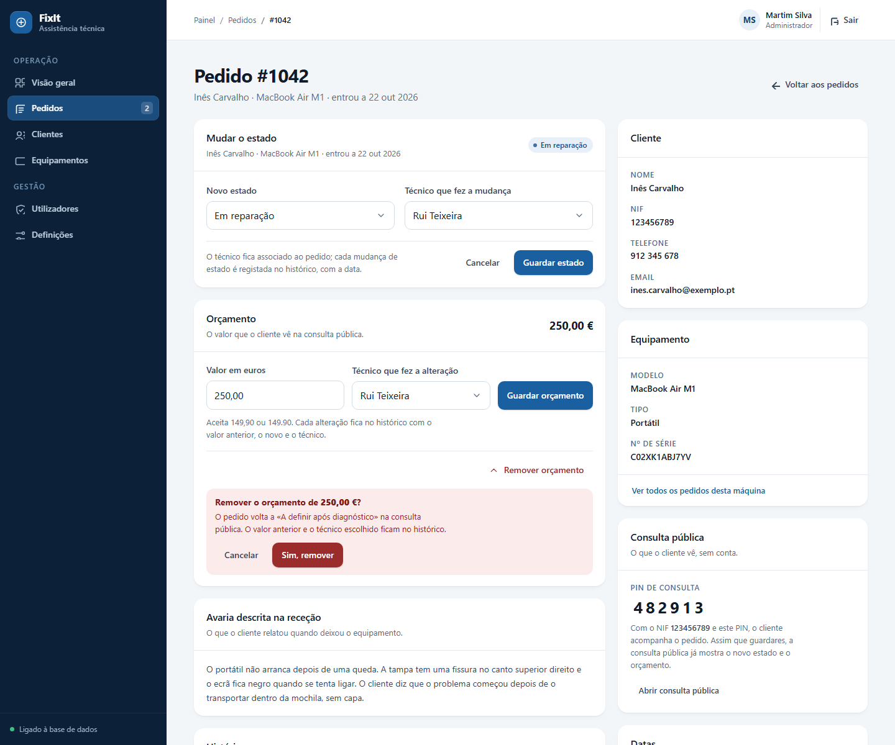

### O que o cliente pode fazer

Na consulta por PIN, o cliente vê o valor e tem dois botões:

| Decisão do cliente | Efeito no pedido |
| --- | --- |
| **Aceitar e reparar** | Passa a **Em reparação** |
| **Recusar e levantar** | Passa a **Pronto**, sem ter sido mexido |

Nenhuma das decisões muda o valor: a oficina é que o escreveu.

### Alterar ou retirar

- **Alterar** o valor é escrever outro e gravar. O valor anterior fica no
  histórico, com data e autor.
- **Retirar** o orçamento é apagar o valor. O cliente volta a ver «A definir
  após diagnóstico» e as decisões anteriores continuam legíveis no histórico,
  com o número com que foram tomadas.

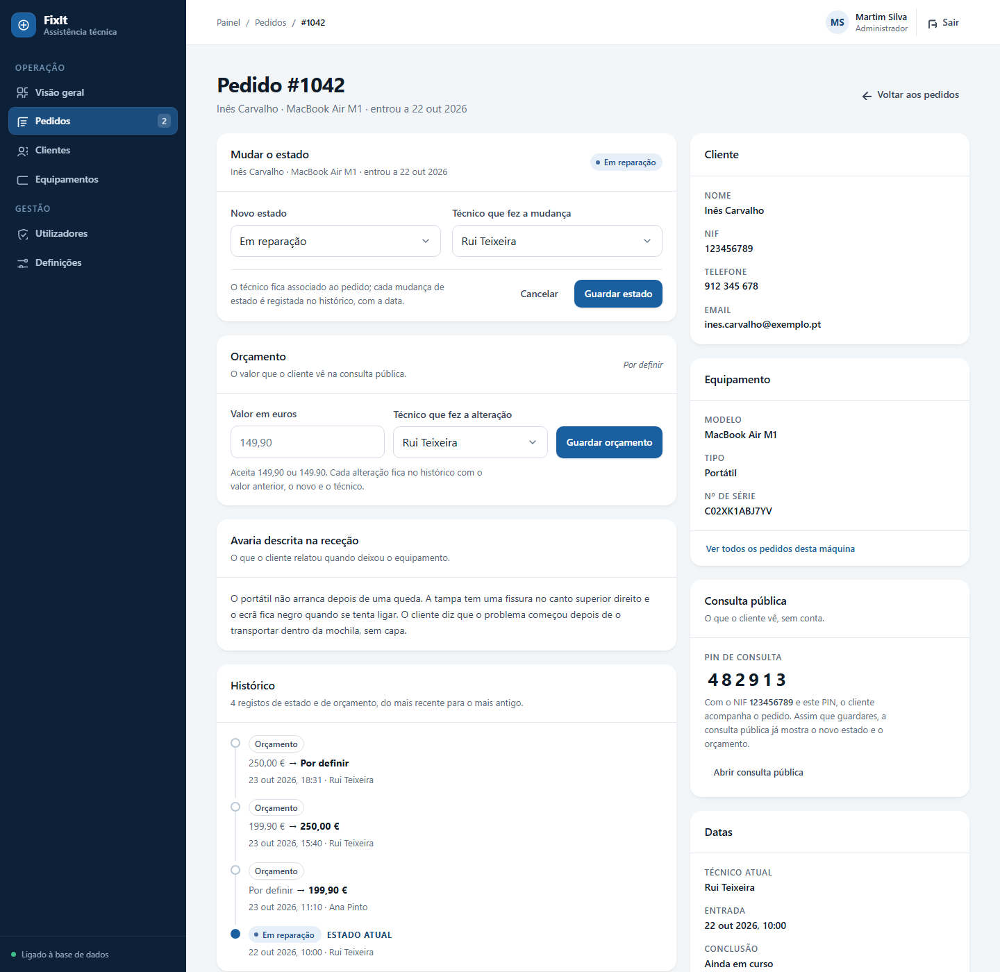

> Se o valor mudar **depois** de o cliente ter decidido, o pedido não recua
> sozinho: a decisão continua registada, e a equipa decide se fala com o cliente
> antes de mexer no estado.

---

## 10. O PIN e a consulta pública

### O que é

O PIN é um número de **6 dígitos**, único entre todos os pedidos, emitido no
registo e entregue no talão. É a única chave da consulta pública: não há login
de cliente.

### Consultar

O cliente abre **Consultar estado** no site, escreve os 6 dígitos e vê:

- o número do pedido e o equipamento;
- o percurso, com as fases concluídas e as datas;
- a avaria, tal como foi escrita no balcão;
- o orçamento e os botões de decisão, quando há valor.

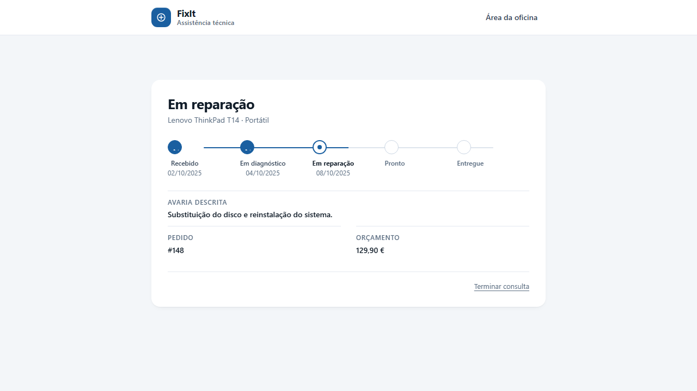

**O nome do cliente não aparece.** Quem tem o PIN reconhece o pedido pelo
equipamento e pelo número; uma página que só pede 6 algarismos não deve mostrar
dados pessoais.

### Renovar o PIN

Na ficha do pedido, em **PIN**, gera-se um novo. O antigo deixa de funcionar
imediatamente. O histórico regista a troca — data, técnico e motivo —, mas não
guarda o código.

### Protecções

| Regra | Valor |
| --- | --- |
| Tentativas por sessão do browser | 8 |
| Tentativas por endereço de rede | 20, partilhadas entre sessões |
| Janela das tentativas | 10 minutos |
| Duração do resultado em sessão | 30 minutos |

Um PIN errado devolve sempre a mesma mensagem, exista ou não o pedido. O PIN não
fica no endereço nem no HTML: é guardado na sessão e o resultado é desenhado a
partir dela.

---

## 11. Pedidos de orçamento do site

Quem visita o site pode pedir orçamento. Esse pedido **não é** uma ordem de
serviço: não gera PIN, não reserva equipamento e não aparece na lista de
pedidos. Aparece na caixa de entrada.

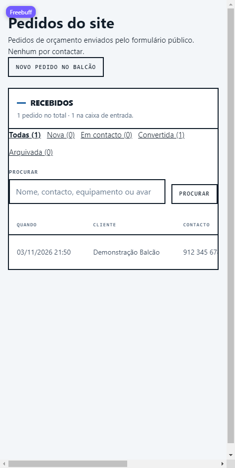

### O que o formulário do site pede

Nome, contacto, tipo de equipamento, marca e modelo (opcional) e a descrição da
avaria. Tem ainda duas protecções invisíveis: um campo-armadilha que os robôs
preenchem e as pessoas não vêem, e um limite de **5 pedidos por 10 minutos** por
endereço de rede.

### Tratar um pedido

1. Abre **Pedidos do site** no menu.
2. Lê o pedido e contacta o cliente pelo telefone ou email indicado.
3. Muda o estado: **Nova → Em contacto → Arquivada** (se não avançar).

**Convertida** não se escolhe à mão: é o resultado da conversão.

### Converter em pedido

1. Abre a solicitação.
2. Carrega em **Abrir pedido**.
3. A aplicação leva os dados para o formulário de pedido novo: confirma o
   equipamento, completa o que falta (NIF, por exemplo) e emite o PIN.
4. Ao gravar, a solicitação passa a **Convertida** e fica ligada ao pedido.

Uma solicitação só pode ser convertida **uma vez**. Se dois técnicos tentarem ao
mesmo tempo, o segundo recebe um aviso em vez de criar um duplicado.

---

## 12. Clientes

**Clientes** lista quem já passou pela oficina. A pesquisa procura por nome,
email, telefone e NIF.

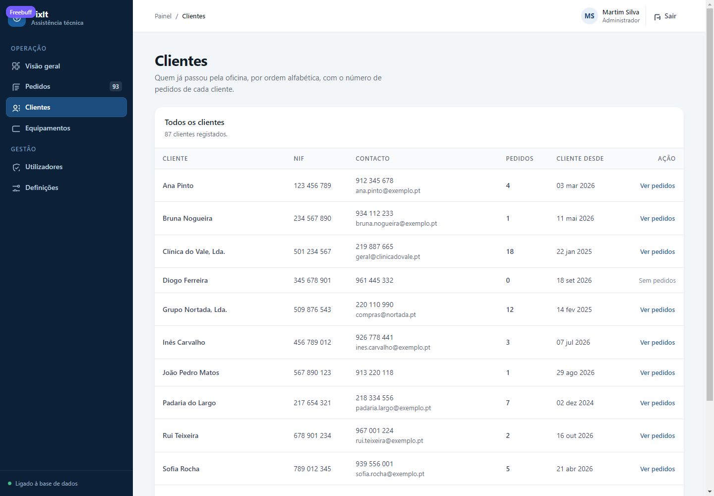

Ao abrir um cliente vês o contacto, o NIF, todos os equipamentos dele e todos os
pedidos — útil quando alguém liga a perguntar «o que é que eu já aqui deixei?».

> **Limitação:** os dados de um cliente não podem ser alterados depois de
> registados. Se um telefone estiver errado, o caminho é registar o pedido
> seguinte com o contacto correcto na descrição. Está identificado no relatório
> como a evolução mais pedida.

---

## 13. Equipamentos

**Equipamentos** lista as máquinas, com pesquisa por marca, modelo, tipo, número
de série e nome do cliente.

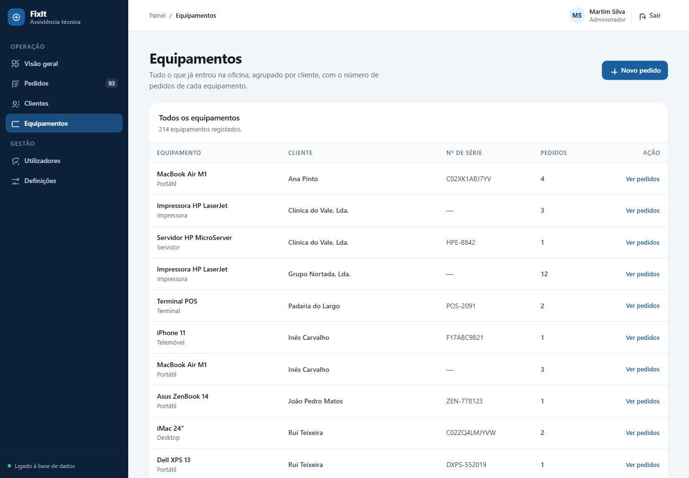

Cada equipamento mostra o cliente, os dados técnicos e os pedidos em que entrou.
Como nos clientes, os dados não se editam depois de registados.

---

## 14. Utilizadores

Só um administrador vê esta página no menu. A um técnico ela nem aparece, e
escrever o endereço à mão devolve-o ao painel.

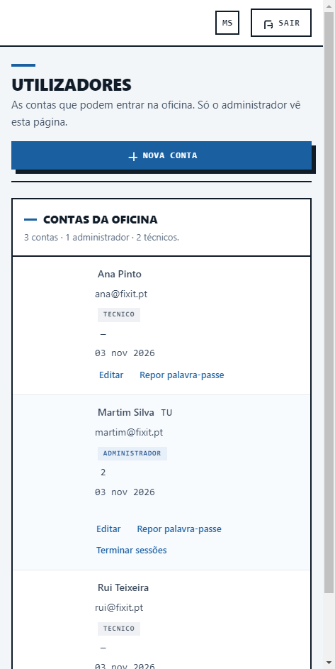

| Ação | O que faz |
| --- | --- |
| **Nova conta** | Nome, email, cargo e palavra-passe inicial (8 caracteres, no mínimo) |
| **Editar** | Muda nome, email ou cargo |
| **Repor palavra-passe** | Define uma nova, para quem se esqueceu |
| **Terminar sessões** | Fecha todas as sessões dessa conta menos a actual |

Um técnico pode fazer tudo o que é trabalho de oficina — pedidos, clientes,
equipamentos, orçamentos, pedidos do site — mas não mexe em contas.

### Administrador ou técnico?

| Pode | Administrador | Técnico |
| --- | --- | --- |
| Ver e alterar pedidos | Sim | Sim |
| Gerir orçamentos | Sim | Sim |
| Ver clientes e equipamentos | Sim | Sim |
| Tratar pedidos do site | Sim | Sim |
| Gerir utilizadores | Sim | Não |
| Mudar a própria palavra-passe | Sim | Sim |

---

## 15. A minha conta

**A minha conta** mostra os teus dados, deixa mudar a palavra-passe e diz
quantas sessões tens abertas.

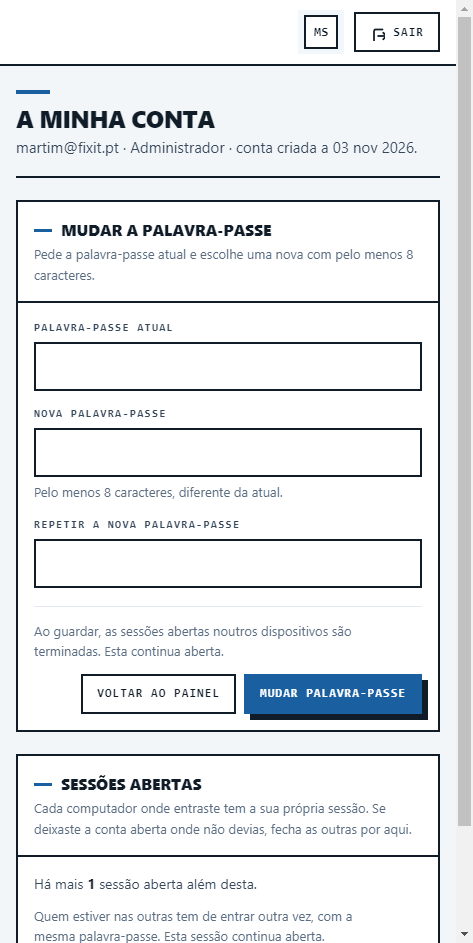

- A palavra-passe nova precisa de **8 a 200 caracteres**.
- Ao mudá-la, as sessões abertas noutros computadores são terminadas; esta
  continua aberta.
- **Terminar outras sessões** fecha as restantes sem mexer na palavra-passe —
  útil quando te esqueceste de sair num computador emprestado.

---

## 16. O site público

O site é a montra da oficina. Não tem login e não mostra nada do back office.

| Página | O que tem |
| --- | --- |
| **Início** | O que a oficina faz, como funciona e o caminho para pedir orçamento |
| **O que reparamos** | Tipos de equipamento e serviços |
| **Como funciona** | O percurso de uma reparação, do balcão à entrega |
| **Perguntas** | Dúvidas frequentes, incluindo prazos e orçamentos |
| **Contacto** | Morada, telefone, email e horário |
| **Privacidade** | Que dados são guardados e para quê |
| **Pedir orçamento** | Formulário que cai na caixa de entrada |
| **Consultar estado** | PIN de 6 dígitos |

### O talão desenhado

A página inicial mostra o próprio talão de entrada: o equipamento, o PIN de
seis algarismos, as cinco fases numeradas e o carimbo da marca. Em **Como
funciona**, o mesmo desenho aparece ampliado no campo do PIN.

Não é fotografia. A oficina não tem imagens próprias e o projecto não inventa
nenhuma: as duas imagens são desenhos guardados em `assets/img/` e servidos pelo
próprio site. Não vêm de fora e continuam a aparecer sem internet.

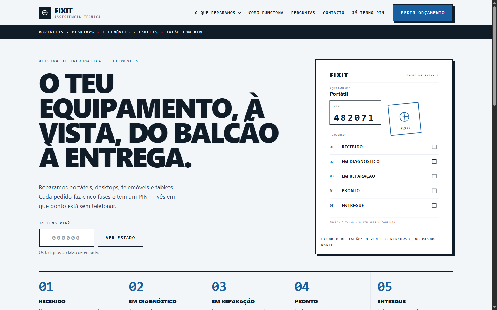

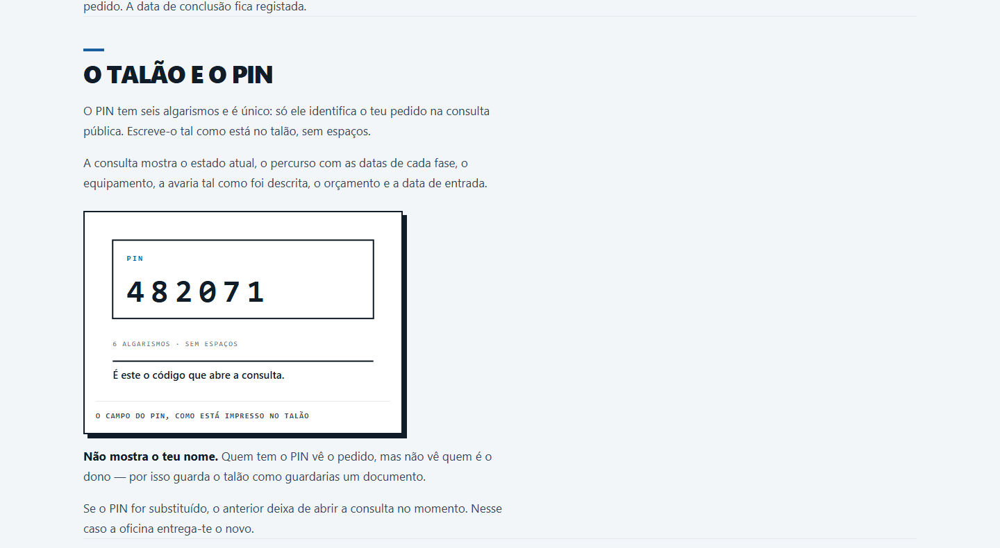

### Pedir orçamento pelo site

1. Abre **Pedir orçamento**.
2. Preenche nome, contacto, equipamento e avaria.
3. Carrega em **Enviar pedido**.

A página confirma com uma referência. **Não há PIN nesta fase** — o PIN só
nasce quando o equipamento entra no balcão e o pedido é registado.

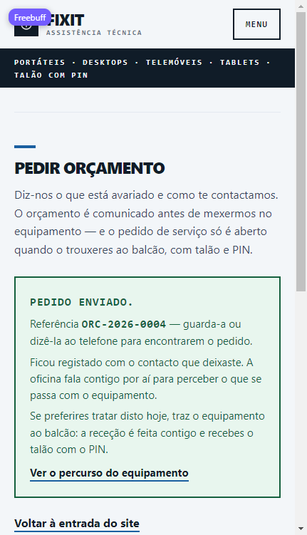

---

## 17. Um dia na oficina

Um percurso completo, do princípio ao fim, para servir de guião:

1. **09:00 — Abrir.** Entrar no back office. O painel mostra os pedidos que
   ficaram por entregar e os avisos de PIN sem consulta.
2. **09:10 — Chega um cliente.** **Novo pedido**, com os dados do cliente, o
   equipamento, a avaria nas palavras dele e duas fotografias. Sai o PIN, que se
   escreve no talão.
3. **09:20 — Diagnóstico.** Abrir a ficha, mudar para **Em diagnóstico**, com o
   técnico que vai pegar nela.
4. **10:30 — Orçamento.** Escrever o valor na ficha. O cliente recebe o PIN e
   consulta; aceita ou recusa.
5. **10:35 — Aceite.** O pedido passa sozinho a **Em reparação**. A equipa
   trabalha.
6. **16:00 — Pronto.** Mudar para **Pronto**. O cliente vê a alteração na
   consulta.
7. **17:30 — Entrega.** Mudar para **Entregue**. Fica a data de conclusão no
   histórico.
8. **Fim do dia.** Verificar a caixa de entrada dos pedidos do site e responder
   aos que chegaram.

Ao longo do dia, a lista de pedidos é o sítio para responder a «em que pé está
o #12?»: pesquisa pelo número, nome ou PIN, e o estado está à vista.

---

## 18. Mensagens e erros

| O que aparece | Porque acontece | O que fazer |
| --- | --- | --- |
| «Email ou palavra-passe incorretos» | Dados errados ou conta desactivada | Confirmar o email; pedir reposição ao administrador |
| A página volta ao login sozinha | Sessão de 8 horas expirada, ou terminada noutro lado | Entrar outra vez |
| «A sessão expirou. Recarrega a página» | O formulário ficou aberto demasiado tempo e o token CSRF caducou | Recarregar e repetir a ação |
| «O pedido já está neste estado, com este técnico» | Tentativa de gravar sem alteração | Escolher outro estado ou outro técnico |
| «Escolhe o técnico que fez a mudança» | Falta o técnico | Escolher um nome na lista |
| «O pedido #N já não existe» | O pedido foi apagado entretanto | Voltar à lista |
| «Demasiados pedidos deste endereço» | Mais de 5 pedidos de orçamento em 10 minutos | Esperar 10 minutos |
| «O ficheiro excede o limite de tamanho configurado no servidor» | Fotografia maior do que o servidor aceita | Reduzir a imagem e repetir |
| «Podes anexar no máximo 5 fotografias» | Demasiados ficheiros | Escolher até 5 |
| «Ainda não há utilizadores registados» | Base de dados sem contas | Criar uma conta em Utilizadores |
| A consulta diz que o PIN não existe | PIN trocado, mal copiado, ou demasiadas tentativas | Confirmar o PIN novo na ficha do pedido e esperar 10 minutos |
| O gráfico do painel não aparece | Sem acesso à biblioteca do gráfico | Usar a legenda ao lado, que tem os mesmos números |
| «Falta aplicar a migração…» | Base de dados desactualizada | Aplicar o ficheiro SQL indicado no README |

---

## 19. Boas práticas no balcão

- **Descreve a avaria com as palavras do cliente.** É o texto que ele vai ler na
  consulta e o que evita discussões à entrega.
- **Fotografa o equipamento à entrada.** Riscos e mossas ficam documentados.
- **Entrega o PIN por escrito.** Sem ele o cliente não consegue acompanhar nada.
- **Regista o orçamento antes de reparar.** É a regra da casa e está no site.
- **Muda o estado no momento em que acontece.** O cliente vê a mudança no
  instante; um estado atrasado gera telefonemas.
- **Fecha a sessão quando sais do balcão.** O botão **SAIR** existe para isso, e
  a sessão dura 8 horas.

---

## 20. Limitações conhecidas

Estas são as limitações reais da versão entregue, não promessas:

1. **Clientes e equipamentos não se editam** depois de registados.
2. **Não há envio de emails.** O contacto com o cliente é telefónico ou pelo
   email que ele indicou, mas a aplicação não escreve por ti.
3. **O site não cria pedidos.** Só o balcão cria ordens de serviço e emite PIN.
4. **Não há exportação** para Excel nem impressão em lote; a consulta pública
   tem um botão de impressão do estado.
5. **A recuperação de palavra-passe é manual**, feita por um administrador.
6. **O limite de pedidos do site é por endereço de rede**, não por pessoa: numa
   rede partilhada (uma escola, uma empresa) o limite é comum.

---

## 21. Glossário

| Termo | Significado |
| --- | --- |
| **Pedido** | Ordem de serviço de um equipamento. Tem número, estado, técnico e PIN |
| **Solicitação** | Pedido de orçamento enviado pelo site; ainda não é uma ordem de serviço |
| **PIN** | Código de 6 dígitos que abre a consulta pública de um pedido |
| **Estado** | Fase do percurso: Recebido, Em diagnóstico, Em reparação, Pronto, Entregue |
| **Orçamento** | Valor proposto ao cliente; o cliente aceita ou recusa |
| **Talão** | O papel que o cliente leva, com o número do pedido e o PIN |
| **Back office** | A área da oficina, com sessão iniciada |
| **Site público** | A parte aberta a qualquer visitante |
| **CSRF** | Protecção que impede outra página de submeter formulários em teu nome |
| **Sessão** | O período em que estás autenticado; caduca ao fim de 8 horas sem atividade |

---

*Manual da aplicação FixIt. Para instalar e arrancar a aplicação, ver
`README.md`. Para as decisões de desenho, ver `DESIGN.md`. Para o relatório do
projecto, ver `RELATORIO.md`.*
