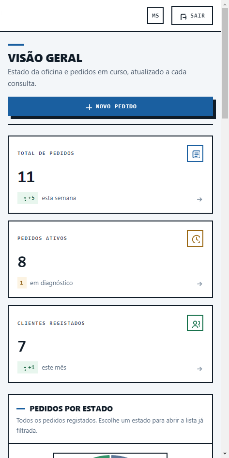
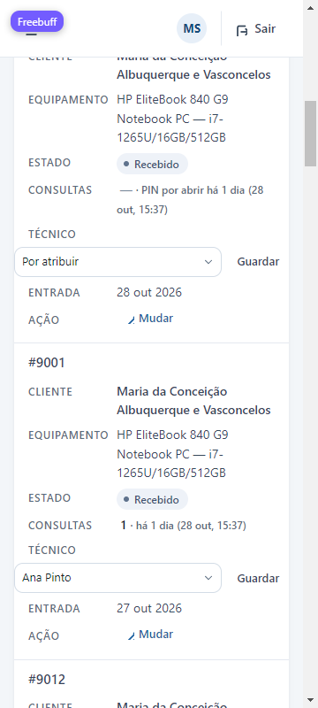

# Relatório do projecto — FixIt

**Autor:** Martim Silva
**Ano lectivo:** 2025/2026
**Entrega:** 5 de novembro de 2026

---

## 1. A empresa e o problema

A FixIt é uma oficina de assistência técnica de bairro que repara portáteis,
desktops, telemóveis e tablets. Trabalha ao balcão: o cliente traz o
equipamento, descreve a avaria e levanta-o quando estiver pronto. Não há recolha
nem envio, nem contratos de manutenção.

O problema que o projecto ataca é o **telefonema de acompanhamento**. Numa
oficina pequena, o cliente liga para saber se o equipamento já está em
reparação, se o orçamento já saiu ou se já pode ser levantado. Cada chamada
interrompe quem está a trabalhar, e a resposta depende de alguém se lembrar do
estado do pedido. Ao mesmo tempo, o registo em papel não diz quando o pedido
mudou de fase, nem quem o mudou, nem que orçamento foi combinado.

O sistema resolve isto de duas formas: dá ao cliente um **PIN de 6 dígitos** no
talão de entrada, com o qual consulta o estado real do pedido quando quiser; e
dá à oficina um **registo cronológico** de cada fase, cada orçamento e cada
técnico, que serve tanto para responder ao cliente como para se defender numa
reclamação.

### Utilizadores

| Utilizador | O que precisa |
| --- | --- |
| **Cliente particular** | Saber se o equipamento tem arranjo, quanto custa e quando está pronto, sem telefonar |
| **Pequena empresa / escritório** | O mesmo, com vários equipamentos em simultâneo e factura |
| **Técnico da oficina** | Registar pedidos, mudar estados, orçar, ver a sua fila de trabalho |
| **Administrador** | Tudo o que o técnico faz, mais a gestão de contas e a visão global |

### Funcionalidades previstas e o que ficou feito

| Funcionalidade | Estado |
| --- | --- |
| Registo de pedido com cliente, equipamento e fotografias | Feito |
| Percurso de cinco fases com histórico e autor | Feito |
| Orçamento com histórico de valores | Feito |
| PIN de consulta pública, com renovação | Feito |
| Consulta pública com decisão do orçamento pelo cliente | Feito |
| Pedido de orçamento pelo site e caixa de entrada | Feito |
| Lista de pedidos com pesquisa, filtros e ordenações | Feito |
| Ficha de cliente e de equipamento com histórico | Feito |
| Gestão de utilizadores com dois perfis | Feito |
| Conta própria, mudança de palavra-passe e sessões | Feito |
| Painel com indicadores, gráfico e fila de trabalho | Feito |
| Alteração de clientes e equipamentos já registados | **Não feito** |
| Envio de email ao cliente | **Não feito** (fora do âmbito) |
| Relatórios exportáveis (CSV/PDF) | **Não feito** |

---

## 2. Pesquisa realizada

> **Secção a completar pelo autor.** O enunciado pede as fontes consultadas;
> esta parte depende da pesquisa que fizeste sobre o sector e sobre oficinas
> semelhantes, e não pode ser inventada por outra pessoa. O que fica abaixo é a
> estrutura e os pontos que o projecto assume.

A pesquisa serviu para três decisões concretas, e é isso que a secção deve
mostrar:

1. **O percurso de cinco fases** (Recebido → Em diagnóstico → Em reparação →
   Pronto → Entregue). Fases a mais tornam o registo pesado para quem tem dez
   pedidos por dia; a menos não distinguem «está a ser visto» de «está a ser
   arranjado», que é exactamente a pergunta do cliente.
2. **O PIN em vez de conta de cliente.** O cliente não quer criar conta para
   saber se o portátil está pronto; um código no talão resolve o mesmo sem
   palavra-passe nem email.
3. **Orçamento antes da reparação.** É a prática do sector e a protecção da
   oficina: ninguém repara sem o valor aceite.

**Pontos a preencher:** oficinas e sites consultados (nome e endereço), datas da
consulta, o que cada fonte confirmou ou contrariou, e o que mudaste por causa
delas.

---

## 3. Tecnologias e ambiente

### Escolhas

| Decisão | Porquê |
| --- | --- |
| **PHP 8 puro, sem framework** | O ambiente escolar tem PHP e MySQL; um framework traria instalação, dependências e um modo de execução a explicar. Com PHP puro, copiar a pasta para `htdocs` é a instalação completa. |
| **PDO com prepared statements** | Todas as consultas passam por parâmetros; não existe uma única concatenação de valores em SQL no projecto. Isto fecha a porta à injecção de SQL por construção, não por disciplina. |
| **MySQL 8 / MariaDB** | Relacional, com chaves estrangeiras, `CHECK` e triggers — as três coisas em que o projecto se apoia para garantir regras na própria base. |
| **`utf8mb4`** | Acentos portugueses e emojis em descrições de avaria sem corrupção. |
| **HTML e CSS próprios, sem bibliotecas** | O site não faz pedidos a servidores de terceiros (à excepção do gráfico, ver §7), funciona offline e carrega instantaneamente. |
| **JavaScript mínimo e sem dependências** | Só o necessário para o menu em ecrã estreito e para o gráfico. Sem isto, a aplicação não depende de JS para funcionar. |

### Ambiente de execução

A aplicação **corre localmente**, com o servidor embutido do PHP e um MariaDB
portátil, e o mesmo código corre em Apache/XAMPP/Laragon sem alterações.

```bash
php -S 127.0.0.1:8141 -t .
```

O endereço local só é acessível no próprio computador — está indicado na
submissão, como o enunciado pede, com as instruções de execução no `README.md`.

### Organização do código

```
nucleo/       conexão, sessão, texto, estados, solicitações (código partilhado)
backoffice/   11 páginas da área da oficina
frontoffice/  12 ficheiros do site público
assets/css/   quatro folhas de estilo
sql/          esquema, migrações e dados
testes/       50 verificações automáticas
```

As páginas do back office não repetem a moldura: `nucleo/layout-painel.php`
desenha cabeçalho, menu, contadores e topo a partir de uma única função. A
primeira versão tinha sete cópias dessa moldura, e cada alteração de menu exigia
sete edições — foi essa duplicação que produziu inconsistências (uma página com
contador, outra sem).

---

## 4. Base de dados

13 tabelas, InnoDB, `utf8mb4_unicode_ci`. O esquema completo está em
`sql/fixit.sql`, comentado tabela a tabela.

### Relações principais

```
clientes 1 ──── N equipamentos 1 ──── N pedidos
                                        │
        ┌───────────────────────────────┼──────────────┬───────────────┐
        │               │               │              │               │
 historico_pedidos  historico_      historico_    consultas_     fotos_
                    orcamentos       pins          publicas       equipamento
                        │
                  decisoes_orcamento, avisos_pin, historico_tecnicos,
                  solicitacoes (pedido_id, único)
```

### Decisões de modelação

- **`pedidos.estado` é o estado actual**; `historico_pedidos` é o percurso. Uma
  tabela de histórico separada permite responder «quando ficou pronto?» sem
  refazer o estado a partir de eventos.
- **`tecnico_id` com `ON DELETE SET NULL`, não CASCADE.** Se a conta de um
  técnico for eliminada, o pedido não pode desaparecer: é histórico e tem valor
  de garantia. Fica sem técnico atribuído, mas mantém-se.
- **`historico_pins` não guarda o PIN.** Guarda quem o trocou e quando. Um
  código que já não abre nada não deve ficar registado.
- **`avisos_pin` tem chave única `(pedido_id, dia)`.** A verificação de PINs
  esquecidos corre a cada abertura do painel; a chave impede que o mesmo aviso
  nasça duas vezes no mesmo dia, mesmo com duas pessoas a abrir o painel ao
  mesmo tempo.
- **`solicitacoes.pedido_id` é único.** É a última defesa contra converter o
  mesmo pedido do site duas vezes; a página ainda bloqueia a linha com
  `SELECT … FOR UPDATE` e condiciona o `UPDATE` a `pedido_id IS NULL`.
- **Regras na base, não só no PHP:** NIF com 9 dígitos, PIN com 6 dígitos,
  orçamento não negativo, `data_conclusao` nunca anterior à entrada, e dois
  triggers que registam o estado inicial e cada mudança — seja qual for o
  caminho que a faça, incluindo uma correcção manual no phpMyAdmin.

---

## 5. Interface e decisões visuais

A identidade vem do talão de oficina: cantos rectos, réguas de 2 px, tipografia
monoespaçada em maiúsculas nos rótulos e uma sombra sólida nos botões, como um
carimbo. A cor é uma família de azuis institucionais; não há imagens
decorativas, ícones de banco de imagens nem fontes externas.



Decisões que resultaram de testes:

- **A moldura é uma só** (ver §3). Além de evitar inconsistências, libertou
  cerca de 1 400 linhas duplicadas.
- **O estado vazio diz o que fazer.** Uma lista sem resultados explica como
  limpar os filtros; uma conta sem sessões diz que só há esta. Uma página vazia
  sem texto é uma página avariada aos olhos de quem chega.
- **O erro fica ao lado do campo.** O formulário público não perde o que foi
  escrito e assinala o campo errado com a razão concreta («Indica um NIF com 9
  dígitos»), em vez de uma mensagem genérica no topo.
- **O gráfico não é a única fonte.** A legenda ao lado tem os mesmos números em
  texto. Sem rede, o gráfico não desenha e a legenda continua a dizer tudo.
- **Ecrãs estreitos.** A 360–390 px o menu recolhe, as tabelas passam a cartões
  e os alvos de toque ficam acima de 44 px.



### A porta da oficina

A entrada não veste o talão, e é a única página do projecto onde isso acontece
por decisão: duas metades iguais, cobalto sólido à esquerda com a marca e a
frase, papel branco à direita com o formulário. A frase é a tese do produto —
«Cada reparação, do balcão à entrega» — e o lugar do depoimento é ocupado por
um facto do balcão, não por uma citação que ninguém disse. As duas famílias
(Bricolage Grotesque e Inter) são servidas de `assets/fonts/`: a entrada
continua sem um único pedido a terceiros.

A revisão de acessibilidade desta página encontrou o que os testes automáticos
não vêem. Os rótulos de 10 px sobre o cobalto estavam entre **2,6:1** e
**4,4:1** e passaram a branco a 90%; o limite dos campos era uma linha de
**1,2:1** sobre o branco, abaixo dos 3:1 que a WCAG pede para identificar um
controlo, e ganhou um token próprio (`--porta-linha-campo`). Medido no browser
sobre a página composta: 17 elementos de texto, nenhum abaixo do mínimo, pior
caso 5,38:1.

O percurso de teclado também mudou: a primeira paragem do Tab passou a ser
«Saltar para o formulário», que só aparece com foco, e cada controlo tem anel
próprio em `:focus` — não em `:focus-visible`, que decide sozinho quando acende
e deixou o foco visível sem anel durante os testes.

### Melhorias feitas depois de testar

- Um técnico conseguia ver o item «Utilizadores» no menu (a página já o
  rejeitava no servidor, mas o menu prometia o que não podia). Passou a ser
  escondido pelo cargo.
- O menu em ecrã estreito fechava ao clicar numa ligação e a navegação perdia-se
  antes de a gaveta sair; passou a esperar pela animação.
- As páginas autenticadas não enviavam cabeçalhos de segurança — podiam ser
  embutidas num `iframe` de outro site. Passaram a enviar, de uma só função.
- O limite de pedidos do formulário público contava as tentativas falhadas:
  cinco gralhas bloqueavam o endereço dez minutos. Passou a contar só pedidos
  gravados.

---

## 6. Testes

### Automáticos

```bash
php testes/correr.php
```

**50 verificações**, todas a passar, com e sem a extensão `mbstring`:

- cortes de texto em bytes (para os limites da base) e em caracteres (para a
  apresentação);
- formatação dos estados e a lista de estados que podem ser escolhidos à mão —
  que exclui «Convertida», porque só a conversão o atribui;
- normalização de contactos, validação de NIF e de PIN;
- percentagens do gráfico e escalões de idade da entrega.

### Contra o servidor a correr

Verificado com `curl` e no browser, com sessão iniciada:

| Verificação | Resultado |
| --- | --- |
| 10 páginas autenticadas | 200, sem avisos PHP |
| Acesso sem sessão | 303 para o login |
| Técnico em `utilizadores.php` | 303 (bloqueado no servidor) |
| Cabeçalhos de segurança | presentes nas 9 páginas da oficina e no site |
| Conversão duplicada de uma solicitação | recusada (3 defesas) |
| Limite do formulário público | 6 tentativas inválidas não bloqueiam; um pedido válido grava |
| CSP em execução | zero violações na consola; gráfico desenha |
| Dados de demonstração | aplicados duas vezes sem duplicar |
| Upload de fotografias | imagem real aceite e visível na ficha; ficheiro falso recusado; 5 passam, 6 não; acima do limite do servidor recusado |

### O que não foi testado

- **Fotografias**: o envio foi testado a sério — ficheiro real, linha na base,
  ficheiro em `uploads/` e imagem servida a 200 — e revelou um defeito: a ficha
  do pedido não mostrava as fotografias que gravava. Passou a mostrar, numa
  galeria com as imagens em tamanho real. O limite também foi testado: cinco
  ficheiros passam, seis são recusados sem criar pedido, e um ficheiro acima
  do `upload_max_filesize` é recusado com a mensagem no próprio campo.
- **Impressão do talão** e **decisão do orçamento pelo cliente** com dados
  reais.
- **Conversões simultâneas** do mesmo pedido do site.
- **Texto com codificação inválida** enviado por `POST` forjado.

### Dificuldades encontradas

- **O ambiente não carregava extensões.** O PHP da máquina tinha as DLL mas
  nenhum `php.ini` as activava; a aplicação dizia «could not find driver». A
  solução foi um `php.ini` de desenvolvimento próprio.
- **Dois servidores no mesmo porto.** Um `php -S` antigo continuava à escuta e
  os pedidos caíam no processo sem extensões, o que fazia parecer que a
  correcção anterior não tinha funcionado.
- **Uma migração de código estragou dois ficheiros.** Uma substituição
  automática com escape a mais escreveu um `\n` literal e apagou uma linha; o
  `php -l` detectou-o de imediato e a correcção foi feita com substituição
  exacta. Ficou como regra: verificar sempre com o *linter* depois de editar em
  lote.

---

## 7. Uso de IA

### Ferramentas

| Ferramenta | Para quê |
| --- | --- |
| Assistente de código **Freebuff (Buffy)** | Apoio à escrita e revisão de código, refactorização da moldura partilhada, revisão de segurança, redacção de documentação técnica |

> **A confirmar pelo autor:** o nome exacto do modelo usado em cada sessão e as
> datas. A tabela deve ficar com o modelo, a tarefa e a data.

### Exemplos concretos do contributo

1. **Moldura partilhada.** As sete páginas do back office repetiam a mesma
   moldura. A IA propôs extraí-la para uma função única; a proposta foi aceite,
   mas com uma alteração: em vez de reescrever as páginas, comparou-se o HTML
   gerado antes e depois para garantir que nada mudava além do contador novo.
2. **Cabeçalhos de segurança.** A IA detectou que só o `login.php` os enviava.
   A primeira implementação punha os quatro `header()` em cada página; foi
   corrigida para uma função única, precisamente para o problema não voltar.
3. **Limite do formulário.** A IA identificou que o contador subia antes da
   validação; a correcção foi mover a gravação para o caminho do sucesso, e
   testada com seis envios inválidos seguidos.
4. **Dados de demonstração.** O SQL foi escrito com a IA e revisto: os `INSERT`
   passaram a estar guardados por chaves naturais para poderem ser importados
   duas vezes sem duplicar.

### O que foi corrigido nas propostas da IA

- Uma substituição automática de texto proposta pela IA estragou dois ficheiros
  (escape a mais). Foi detectada pelo `php -l` e corrigida à mão.
- A IA sugeriu inicialmente substituir o gráfico por SVG desenhado no servidor,
  o que perderia as dicas de contexto e o clique-para-filtrar. A sugestão foi
  recusada e a dependência ficou registada como decisão pendente.
- A IA escreveu uma versão do README a dizer «12 tabelas»; a contagem real é 13
  e foi corrigida por verificação no `information_schema`.

---

## 8. Funcionalidades concluídas, limitações e melhorias

### Concluído

Registo e acompanhamento de pedidos com histórico completo; orçamentos com
histórico de valores e decisão do cliente; consulta pública por PIN; caixa de
entrada com conversão transaccional; lista com pesquisa, filtros e ordenações;
fichas de cliente e equipamento; gestão de contas com dois perfis; painel com
indicadores e gráfico; validação de formulários com mensagens por campo; 50
testes automáticos; documentação (`README`, manual, este relatório, sistema
visual e diário técnico).

### Limitações

- **Clientes e equipamentos não se editam nem se apagam.** É a lacuna funcional
  mais visível: corrigir um telefone exige um pedido novo.
- **O gráfico depende de um CDN** (Chart.js, versão fixa e `integrity`). Sem
  rede, o gráfico não desenha; a legenda mantém-se.
- **Sem envio de email.** O contacto é telefónico, como no balcão.
- **Sem paginação** — as listagens foram pensadas para o volume de uma oficina.
- **Sem relatórios exportáveis** (CSV/PDF).

### Melhorias futuras, por ordem de valor

1. Editar e arquivar clientes e equipamentos (a lacuna identificada).
2. Desenhar o gráfico no servidor, sem dependência externa.
3. Exportar a lista de pedidos para CSV, para contabilidade.
4. Enviar ao cliente um email quando o orçamento fica disponível.
5. Anexar as fotografias ao talão impresso.
